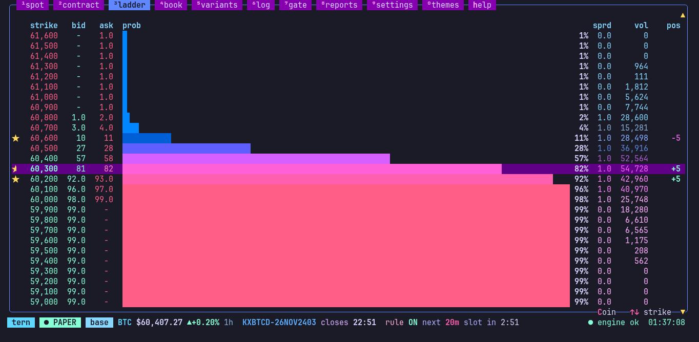
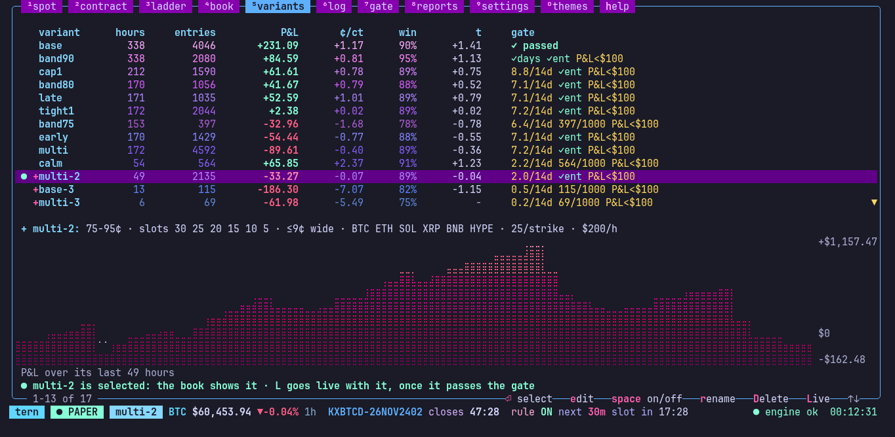
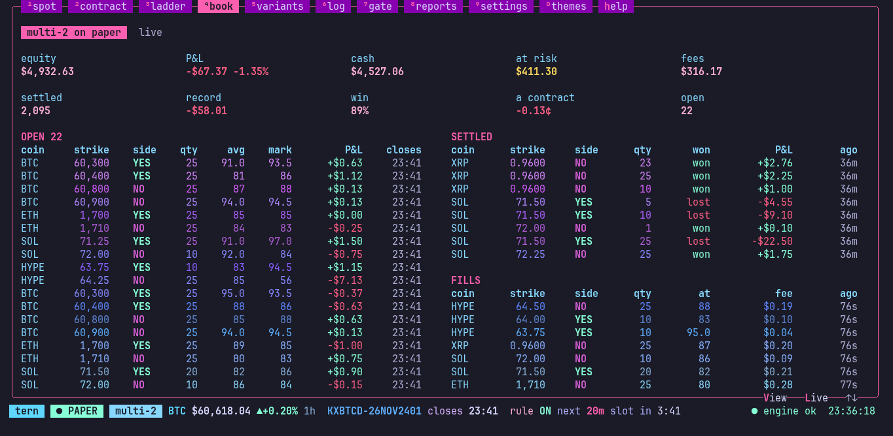
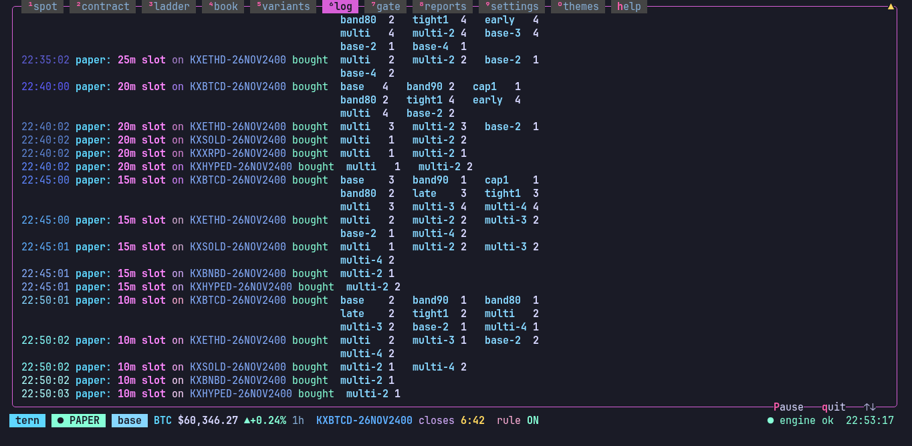
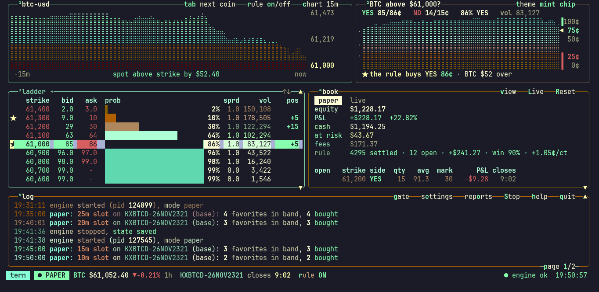

# tern

tern is a trading bot for Kalshi's hourly crypto above-or-below markets (BTC, ETH, SOL, XRP, BNB, HYPE),
with a btop-style terminal screen: braille charts, a strike ladder, and paper and live books.
Every trade comes from its rule; there are no manual orders.
It paper trades from the start and sends no real order until you arm live.



- **Paper and live books.** Live is off until you arm it, and has its own caps, gate and daily loss limit.
- **Variants.** Ten built-in versions of the rule run side by side on paper, each with its own record. Make your own from the screen.
- **Profiles.** Whole copies of the bot with their own variants and settings, compared on the same prices.
- **Reports.** Every variant's and profile's record on one screen, live or saved, with a weekly one if you want it.
- **Runs unattended.** The engine is separate from the screen and can run as a systemd service.
- **Web screen.** The same screen in a browser, view only.
- **54 color themes.**

## Quick start

tern needs Linux and Python 3.11 or newer, and nothing from pip. Paper trading needs no Kalshi account.

```
git clone https://github.com/samruger/tern.git
cd tern
python3 -m tern
```

That opens the screen and starts the engine in paper. `h` shows the help and `q` closes the screen; the
engine keeps running.

| Command | What it does |
|---|---|
| `python3 -m tern` | the screen; starts the engine in paper if it isn't running |
| `python3 -m tern run` | the engine in the foreground |
| `python3 -m tern status` | a plain-text summary |
| `python3 -m tern report` | profile 1's variants side by side, built in and its own |
| `python3 -m tern report --profiles` | every profile's book side by side (`--deleted`: the deleted ones) |
| `python3 -m tern report --profile NAME` | one profile's variants, by settings period |
| `python3 -m tern report --save` | saves a summary (status, variants, profiles) as `runtime/report-*.txt` |
| `python3 -m tern report-timer` | writes a systemd user timer that saves one every Monday at 10:00 |
| `python3 -m tern live-check` | tests your Kalshi key: balance and positions, no orders |
| `python3 -m tern service` | writes a systemd user service that keeps the engine running |
| `python3 -m tern web` | the screen in a browser: http://localhost:8787/ |
| `python3 -m tern web-service` | writes a systemd user service for the web screen |
| `python3 -m tern web-password` | sets the web screen's password |
| `python3 -m tern web-cert` | makes a self-signed certificate for the web screen |
| `python3 -m unittest tests.test_tern` | the tests |

## The rule

At **25, 20, 15 and 10 minutes before each hourly close**, for every strike whose
favorite side (YES or NO) has its mid between **75¢ and 95¢** and a spread of
**2¢ or less**, tern buys **5 contracts** of the favorite at the ask
(immediate-or-cancel) and holds to settlement. It puts at most **$60** into any
one hour. It trades BTC by default; `r` on another coin's view adds that coin (a rule change, see Variants).
These are the defaults, under `strategy` in `runtime/config.json`, which is
re-read every 5 seconds. The screen never changes the band, slots, spread or coins there: a rule
changed from the screen is a new variant (see Variants).

The rule comes from a study of 67 days of BTC and 14 days of ETH markets. In the BTC data, 80–90¢
favorites won about 2 points more often than their price said, and 5–20¢ long shots about 2 points less
often. The rule was picked on the first 33 days and made +0.6¢ a contract after fees on the next 34.
The write-up is [research/RESEARCH.md](research/RESEARCH.md).

## The screen

The boxes sit on two pages, and `p` flips between them. Page 1 · trade has spot, contract, ladder, book
and log. Page 2 · compare has variants across the full width, then profiles and equity, then log. Each
page fits itself to the terminal: tables keep all their rows and the charts give up height first. A screen big
enough for every box (about 150×45) shows them all as one page. Each page numbers its boxes in reading order
(page 1: 1–5, log is 5; page 2: 1 variants, 2 profiles, 3 equity, 4 log), and `page 1/2` at the log's bottom
right says which page it is. A box's number zooms it to the whole screen; the same number again (the bottom border says `3 back`)
restores the page, and `p` restores it and flips.



| Box | What it shows |
|---|---|
| status line | paper/live, spot and 1-hour change, the event and its countdown, the rule's next slot, engine health |
| ¹ spot | Coinbase spot (a BRTI constituent), over 5 minutes, 15 minutes, 1 hour or 24 hours (`c`), with the selected strike as a dotted line |
| ² contract | the selected strike's YES price this hour, seeded from Kalshi's minute candles, with the rule's band edges marked |
| ³ ladder | every strike, high to low: bid, ask, probability bar, spread, volume, your position. ★ marks strikes in the rule's band |
| ⁴ book | equity, P&L, cash, at risk, fees, the rule's paper record, and open positions. `v` switches between paper and live |
| ⁵ log | what the engine did (page 2: ⁴) |
| ¹ variants (page 2) | each variant's record and gate progress, ● on the one in use, + on the ones you made, and the highlighted one's P&L by hour |
| ² profiles (page 2) | profile 1 and the profiles you made (see Profiles) |
| ³ equity (page 2) | that book's equity by the minute |

## Variants

The engine runs these built-in variants on paper, side by side, each with its own record and real fees. The paper and live
books trade whichever one `strategy.variant` names (`base` by default). Pick it in the variants box (`p`,
page 2) with `↑↓` and `enter`. While live is on or armed, switching asks you to type `live`.

| Variant | What it does |
|---|---|
| `base` | the rule under `strategy` in `config.json` |
| `band90` | only favorites at 90–95¢ |
| `cap1` | the rule, but at most one entry per strike per hour |
| `band80` | only favorites at 80–90¢ |
| `late` | only the 15m and 10m slots |
| `tight1` | only strikes with a 1¢ spread |
| `band75` | only favorites at 75–80¢; with `band80` and `band90` it splits the band in three |
| `early` | only the 25m and 20m slots, the other half of `late` |
| `multi` | the rule on every coin at once, each coin's hour with its own budget. Its dollars are up to six times `base`'s, so compare it by ¢/contract and t |
| `calm` | skips a slot when the coin's realized volatility over the last hour (one-minute returns) is above 7.6 bp/min |

Two earlier variants are retired: `stop20` (sell 20¢ under entry) and `arb` (a cross-strike pair under $1).

### Your own

A variant you make is a whole rule: band, slots, max spread, coins, entries a strike and most volatility.
It belongs to the profile you are viewing and is marked `+` in the variants box. With that box focused:

- **`n` makes one**, a copy of the highlighted variant under a name you type, with an empty record. Its rule opens next.
- **`E` changes the highlighted one's rule.** The RULE rows in settings (`e`) do the same for the one in use.
- **`D` deletes one** (it asks `y`). If it bought anything its record stays on file and open entries settle.
- **`N` renames it**, `enter` uses it, `w` watches it, as with any variant.

A record is always one rule's. The built-in variants never change from the screen, and neither does one that
has bought anything: changing its rule makes a new variant (`band80-2`) with an empty record, and the
book moves to it if it was the one in use. A variant with no entries yet changes in place. The gate judges
each on its own record, and a change to the rule live trades asks you to type `live` while live is armed.
If the variant a profile was set to is missing from
`variants.json`, its paper book trades `base` and live waits until you pick one. `r` is a rule change too. At most 12 in each profile, kept in `variants.json` beside its records.


### Watching one

To look at a variant without trading it, highlight it and press `w`. The book,
equity, ladder and band then show that variant's shadow record as if it traded
(on a $1,000 paper start), and the status line says `watching X · trading Y`.
Nothing about what trades changes. `w` again or `v` goes back to the real book.


The engine also records what it sees to `runtime/ticks/`: every 5 seconds, each near-the-money strike's
bid, ask and sizes with spot, plus each hour's results (about 2 MB a day, gzipped). Kalshi keeps only
minute candles, so this is finer data for testing ideas.

## Two weeks on paper

`python3 -m tern report` after two weeks, taken 2026-11-23. The paper book went from $1,000.00 to
$1,220.26, with $166.38 paid in fees. Each variant's record, after fees, from the day it was added:

| Variant | Since | Hours | Entries | P&L | ¢/contract | Win | t |
|---|---|--:|--:|--:|--:|--:|--:|
| `base` | 11-09 | 323 | 3,853 | +$252.23 | +1.34 | 90% | +1.59 |
| `band90` | 11-09 | 323 | 1,972 | +$90.70 | +0.92 | 95% | +1.25 |
| `cap1` | 11-15 | 197 | 1,463 | +$72.03 | +0.99 | 89% | +0.91 |
| `band80` | 11-16 | 155 | 952 | +$27.30 | +0.57 | 87% | +0.35 |
| `late` | 11-16 | 156 | 931 | +$30.07 | +0.64 | 89% | +0.47 |
| `tight1` | 11-16 | 157 | 1,854 | +$21.14 | +0.23 | 89% | +0.18 |
| `band75` | 11-16 | 140 | 366 | −$20.45 | −1.13 | 78% | −0.50 |
| `early` | 11-16 | 155 | 1,291 | −$26.87 | −0.42 | 88% | −0.29 |
| `multi` | 11-16 | 157 | 4,134 | −$66.04 | −0.33 | 89% | −0.27 |
| `calm` | 11-20 | 47 | 501 | +$50.51 | +2.05 | 91% | +0.96 |
| `stop20` (retired 11-16) | 11-09 | 165 | 2,140 | −$190.72 | −1.82 | 68% | −3.01 |

Hours are the hours a variant traded. `multi` trades all six coins and the rest trade BTC. t is the average
hour's P&L divided by its standard error. These are paper results.

## Profiles

A profile is a whole copy of the desk on paper with its own variants, contracts a
strike, most an hour, paper start, and the variant its book trades. The built-in
variants and its own run in it, on the same prices at the same moment as the
desk, so a difference between two profiles comes from their variants and
settings, not from timing.

- **Profile 1 is the desk:** the paper book, live and the gate, with its files
  directly in `runtime/`. Live trades profile 1's rule unless `d` picks another profile.
- **Make one** in the profiles box (`p`, page 2; `←→` to focus it), then `n`. It starts
  with profile 1's settings, the variant it trades and empty records. `enter` views it: the book,
  equity, variants box and settings box then show that profile. Viewing changes
  nothing about what trades. `space` turns one off (no new entries, open ones
  still settle) and on. `D` deletes it after you type `delete`; its folder moves
  to `runtime/profiles-deleted/`, nothing is erased. At most 8 besides profile 1.
- **Pick what goes live** with `d`: live then trades the highlighted profile's rule (its variant, band,
  slots, spread, coins and hourly budget) and its row is marked `L`. Live's own size and caps stay as they
  are. The gate is judged on that profile's own record of its variant, so a new pick starts its own
  clock. A live profile that is off or gone enters nothing, even with `live.auto_needs_gate` off: live
  never falls back to profile 1 by itself. While live is armed, `d` and any change to the live profile's
  variant or settings ask you to type `live`. The live profile can't be deleted (`d` another one first).
  Profile 1's paper book keeps trading profile 1's rule. It is `live.profile` in `config.json`.
- **Rename** with `N`: in the profiles box it renames the highlighted profile
  (profile 1 too; an empty name gives "profile 1" back), in the variants box it
  gives the highlighted variant a display name (up to 12 characters; empty gives
  its own back; a built-in one's shows in every profile). A variant's record, the gate, `config.json` and `tern report`
  keep its own name, so renaming never splits a record. Names live in
  `runtime/names.json` (profile 1, built-in variants) and each profile's `profile.json`
  and `variants.json`.
- **Change its settings** with `e` while viewing it. Every change is written
  down with its time (`runtime/profiles/<id>/settings-log.jsonl`;
  `runtime/settings-log.jsonl` for profile 1), and a change to the size or hourly budget
  starts a new settings period. A rule change is a new variant instead. Rows are stamped with their period, so
  results can be split by it. ALERTS and WEB are for the whole desk and show under every profile;
  LIVE and GATE are under profile 1.
- **Compare:** `python3 -m tern report --profiles` puts each profile's book
  side by side; `--profile <name>` shows one profile's variants period by
  period with what changed; `--deleted` lists the deleted ones.

When comparing, look at entries and t as well as P&L. t is the average hour's P&L divided by its
standard error; it shows after 10 hours.

The web screen can view any profile. Making, changing and deleting them is done
in the terminal.

A profile from before variants could be made (2026-11-23) is converted once, when the engine starts: a rule
it had changed becomes variants of its own with the entries they bought. The one its book traded and
`base` keep running; the others are kept as deleted. The files as they were stay beside them
as `*.pre-variants`, and `variants-upgraded` marks it done.




## Paper and live

Paper fills at the touch, limited to the size shown there, and pays the taker
fee rounded up per order, as Kalshi charges. Paper always runs the rule, even
while live is on, so its record keeps growing.

**Going live:** press `L` and type `live`. That sets `live.enabled` in the
config. The engine then authenticates with your Kalshi key, and the status line turns red
once Kalshi accepts it. Press `L` again to return to paper. Once live:

- **The variant in use goes live only after its own shadow record passes the
  gate** (`g`): 14 days, 300 settled entries, and P&L ≥ $0 after fees. Days are
  counted as hours it actually traded ÷ 24, so time with the engine off does
  not count. Switching variants never skips this: the new one needs its own record.
  14, 300 and $0 are the defaults; the settings box (`e`) changes them.
  Set `live.auto_needs_gate` to `false` to skip the gate.
- **Caps:** `live.capital_usd` ($100) is the most at risk at once.
  `live.max_order_usd` ($25) is the largest single order. Orders that only
  reduce a position are exempt from both.
- **Kill switch:** a live loss of `live.max_daily_loss` ($30) since local
  midnight turns live off. Open positions are left to settle. Every order is
  immediate-or-cancel, so nothing is left resting on the book.
- **Kalshi is the record.** Every 15 seconds the engine reads your positions
  and overwrites its own when they differ. It reads the balance every 10
  seconds. Each order carries a unique `client_order_id`. If the reply is lost,
  the engine looks the order up by that id instead of sending it again.



The gate box (`g`) shows the checks, the variants and the live caps. Here it has been set stricter than
the defaults, to 1000 entries and $100:


## Kalshi key

Only live trading needs a key. At kalshi.com, under Account → API keys, create one and download the private
key file. Ed25519 is Kalshi's default; RSA works too. Make the folder, save the file in it as `kalshi.pem`,
and write your key ID next to it:

```
mkdir -p ~/.config/tern && chmod 700 ~/.config/tern
cat > ~/.config/tern/kalshi.env <<EOF
KALSHI_KEY_ID=your-key-id
KALSHI_KEY_FILE=~/.config/tern/kalshi.pem
EOF
chmod 600 ~/.config/tern/kalshi.env ~/.config/tern/kalshi.pem
python3 -m tern live-check
```

Requests are signed (Ed25519 or RSA-PSS) in pure Python, checked against openssl in the tests.

## Keys

| Key | What it does |
|---|---|
| `p` | page 1 / page 2 |
| `1`–`5` | zoom a box to the whole screen; the same number goes back (`1`–`4` on page 2, `1`–`8` on one big screen) |
| `←→` | move between boxes |
| `↑↓` `j` `k` `PgUp` `PgDn` | move in the focused box; the mouse wheel scrolls the box under the pointer |
| `tab` / shift+tab | next / previous coin |
| `c` | chart span: 5m, 15m, 1h, 24h |
| `t` / `T` | next / previous color theme |
| `v` | paper / live book |
| `w` | watch the highlighted variant (view only) |
| `enter` | use the highlighted variant, or view the highlighted profile |
| `r` | the rule trades this coin, on / off |
| `g` | the gate |
| `e` | settings |
| `o` | reports (below) |
| `L` | arm / disarm live |
| `R` | reset the paper book (asks `y`) |
| `S` | stop (asks `y`) / start the engine |
| `s` | in the reports: save the one shown |
| `h` or `?` | help |
| `q` | close the screen; the engine keeps running |
| `space` `n` `d` `D` | profiles box: on/off, new, live trades its rule, delete |
| `n` `E` `D` | variants box: new, change its rule, delete |
| `N` | rename the highlighted profile or variant |

### Reports

`o` opens the reports over the whole screen; the status line stays. The list on the left has two parts:

- **LIVE:** what `tern report` prints, worked out from the records as they stand: profile 1's variants, every
  profile's book side by side, each profile by settings period, and the deleted profiles. A report is worked out
  again when its records change; its bottom border says when it was.
- **SAVED:** the files named `report-*.txt` in `runtime/`, newest first, shown as written. `s` saves the live report
  on screen, `python3 -m tern report --save` a summary, and the weekly timer does that by itself:

```
python3 -m tern report-timer
systemctl --user daemon-reload
systemctl --user enable --now tern-save-report.timer
```

`←→` moves between the list and the report, `↑↓` picks or scrolls, `PgUp` `PgDn` page the report, and `esc` closes
them. Reading one changes nothing, so the web screen has them too, without `s`.


## Themes

`t` and `T` step through 54 color themes. Full color needs a 256-color terminal. Sunset and mint chip:




## The web screen

`tern web` serves the screen at http://localhost:8787/ (`--port` to move it). It is not a copy of the
screen: each browser tab runs the real screen code on a virtual terminal, and the page paints its cells
with the colors and font from foot's config if there is one, or a built-in set. So it looks and behaves the same: `p` pages, box numbers, `c`
chart span, `tab`/shift+tab coins, `t`/`T` themes, `v` paper/live, `w` watch a variant, `g` gate, `h`
help, `↑↓ ←→` and the wheel. Clicking a key on a box border, a box's number, or a ladder or variant row
does what the key would; on a phone, drag to scroll.

It is view only. `q`, `S`, `s`, `R`, `L`, `r`, `N`, `E` and `enter` on a variant do nothing there, nor do `space`,
`n`, `d` and `D` in the variants and profiles boxes, and their hints are not drawn. `enter` on a profile views it, and the
settings box (`e`) shows the settings but changes only what that browser's log box shows.
The web screen writes no command files and never touches the terminal's `dash.json` or `view.json`: each browser keeps its own settings. It writes `view-web.json` (in the same tmpfs folder)
with the coins and strikes its viewers have up, so the engine sends those strikes' contract history
too; the engine ignores the file 30 seconds after the last viewer leaves.


**Remote access.** Off localhost (`--host 0.0.0.0`) it will not start without a password and a TLS certificate.

```
python3 -m tern web-password
python3 -m tern web-service --host 0.0.0.0
systemctl --user daemon-reload
systemctl --user enable --now tern-web
```

The certificate can be either of these, put in place before the service starts:

- **Your own**, from Let's Encrypt or any other authority: save the full chain as
  `~/.config/tern/web-cert.pem` and its private key, without a passphrase, as `~/.config/tern/web-key.pem`
  (`chmod 600` both). Restart `tern-web` after renewing it.
- **Self-signed:** `python3 -m tern web-cert` makes one (it needs openssl) and prints its fingerprint.
  Browsers warn about a self-signed certificate; check that the fingerprint they show matches.

The password is stored as a PBKDF2 hash in `~/.config/tern/web.json`. A sign-in lasts 30 days in an HttpOnly,
Secure, SameSite=Strict cookie. After a new password, restart `tern-web`: every browser is then signed out.
`/logout` signs out the one you are on. Five wrong tries from one address make it wait 15 minutes, and 30 from
everyone make every sign-in wait. To reach it from another network, allow the port (8787 by default) through
the host's firewall, and forward it to the host if there is NAT in between.

**Settings box (`e`), WEB.** `web screen` turns it on and off, `port` moves it and `open to the
network` switches between every address and localhost only. tern-web.service runs
`tern web --config`, which reads those from `config.json`'s `web` section and exits (and stays down)
when it is off. The engine restarts or stops the service as soon as one changes, from the box or by
hand in `config.json`, and the box shows whether it is running and where to open it. Firewall and
port-forwarding rules are not touched: a new port needs its own.

## Files

`runtime/` (gitignored) holds `config.json`, `state.json` (the books as they
stand, open entries, slots taken: a few KB, written only when it changes, with
an hourly `state.json.bak` that is loaded if the main file is damaged), the
history files that are only ever appended to (`paper-trades.jsonl`,
`paper-curve.jsonl`, `live-trades.jsonl`, `live-curve.jsonl`,
`rule-entries.jsonl`), the variants' records (`shadow.json`, open entries, and
`shadow-settled.jsonl`, append-only), `settings-log.jsonl`, `names.json` (display
names, once something is renamed), `variants.json` (your own variants, once there are any), `dash.json` (the screen's preferences), `ticks/`,
`tern.log` and `cmd/` (settings commands from the screen). Each extra profile has a folder under
`profiles/` with its own `profile.json`, `config.json`, `variants.json`, variants' records and
`settings-log.jsonl`; a deleted one moves to `profiles-deleted/`. The live
status file and the screen's selection live in tmpfs (`$XDG_RUNTIME_DIR/tern-*`),
because they are rewritten every second.

| Module | What it does |
|---|---|
| `config.py` | the settings, their defaults and the settings box's bounds |
| `strategy.py` | the favorite rule: which strikes qualify, when a slot is due |
| `book.py` | the ledger for paper and live, with Kalshi's YES-leg netting and fee |
| `engine.py` | polling, the rule, orders, settlement, live reconcile, kill switch, status |
| `net.py` | HTTPS over connections that stay open |
| `kalshi.py` | public and signed REST, V2 orders (`/portfolio/events/orders`) |
| `sign.py` | Ed25519 and RSA-PSS signing, PEM/DER parsing |
| `spot.py` | Coinbase ticker and candles |
| `shadow.py` | the built-in variants, and every variant's paper record (also each one's gate) |
| `variants.py` | the variants you make: their rules, names and file |
| `profiles.py` | profiles: their folders, settings, records and names |
| `record.py` | writes quotes and results to `runtime/ticks/` |
| `dash.py` | the curses screen |
| `themes.py` | the screen's 54 color themes |
| `web.py`, `web.html` | the same screen in a browser, view only |
| `webctl.py` | starts, stops and asks about tern-web.service for the settings box's WEB rows |
| `webauth.py` | tern web's password, sign-in cookie, wrong-guess limits and certificate |
| `research/` | the study's scripts and write-up |

## Notes

- Live order handling follows Kalshi's V2 docs. It has not yet been run with a real order. Start live with
  small caps and watch the first fills against kalshi.com.
- If the engine isn't running, nothing is watched. Positions still settle on
  Kalshi, because nothing rests on the book.

## Changes

The major ones, newest first.

| Date | Change |
|---|---|
| 2026-11-23 | **GPL license** (version 3 or later) instead of MIT. Copies from before this stay under MIT. |
| 2026-11-23 | **Your own variants.** Make, change and delete them from the screen (`n`, `E`, `D`), in each profile. Changing a rule makes a new variant with its own record; the built-in ones never change. Profile 1's settings show its variant and rule. Profiles that had changed their rule are converted (see Profiles). |
| 2026-11-23 | **Reports screen** (`o`): what `tern report` prints, from the records as they stand, and the saved `report-*.txt` files. `s` there saves one, and `tern report-timer` sets up a weekly one. `S` (was `s`) stops and starts the engine. |
| 2026-11-23 | MIT license; README rewritten for anyone running it. |
| 2026-11-22 | **Any profile can go live** (`d`), past its own gate on its own record. |
| 2026-11-22 | Two pages (`p`), and a box's number zooms it to the whole screen. Hiding boxes is gone. |
| 2026-11-22 | `N` renames profiles and variants. The web screen's on/off, port and network are in the settings box. |
| 2026-11-21 | **Profiles:** copies of the desk with their own settings and records, and settings periods in the records. |
| 2026-11-21 | The web screen is back, with a login and HTTPS. |
| 2026-11-20 | Settings box (`e`), a size of its own for live, desktop alerts, log filter. |
| 2026-11-19 | Variant `calm`. |
| 2026-11-17 | The web screen, view only. |
| 2026-11-16 | **Variants box:** pick what trades, each with its own gate. New: `band80`, `late`, `tight1`, `band75`, `early`, `multi`. Retired: `stop20`, `arb`. `w` watches one. |
| 2026-11-16 | 54 color themes. History moves to append-only files, and HTTPS connections stay open. |
| 2026-11-15 | Manual orders and the auto switch are gone: the rule always trades. SOL, XRP, BNB and HYPE added. Variant `cap1`. |
| 2026-11-09 | Variants and the quote recorder. The daily loss limit measures realized plus open P&L, and the gate counts hours traded. |
| 2026-11-08 | First version. |

## License

Copyright (C) 2026 samruger

tern is free software: you can redistribute it and/or modify it under the terms of the GNU General Public License
as published by the Free Software Foundation, either version 3 of the License, or (at your option) any later
version. It is distributed in the hope that it will be useful, but WITHOUT ANY WARRANTY; without even the implied
warranty of MERCHANTABILITY or FITNESS FOR A PARTICULAR PURPOSE. See [LICENSE](LICENSE) for the details.
