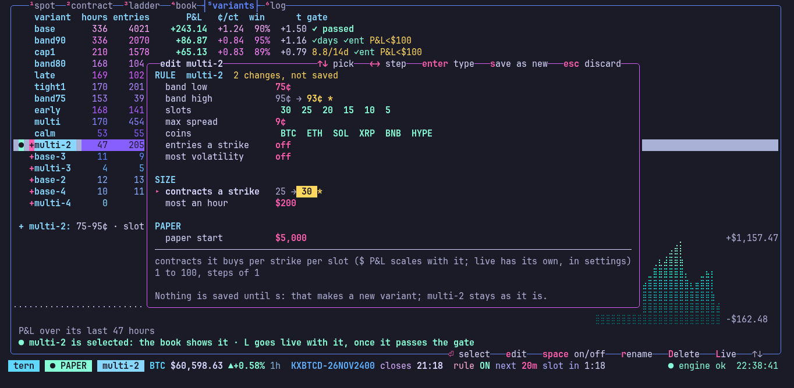
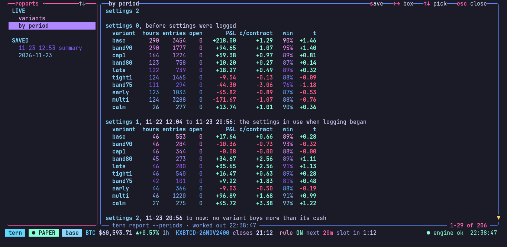
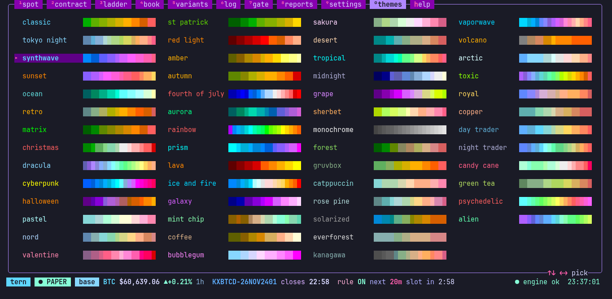
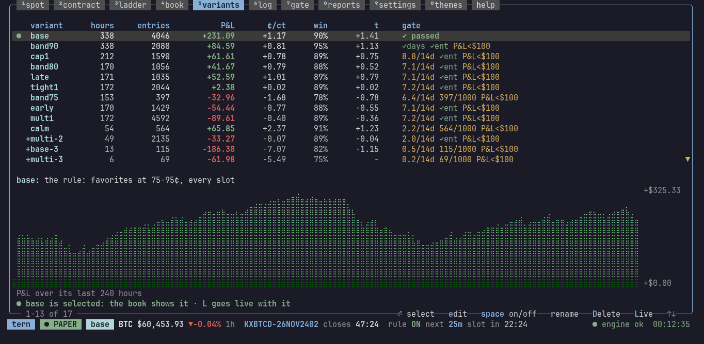
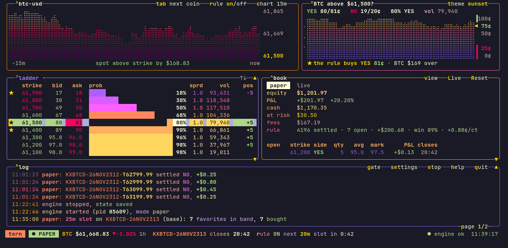
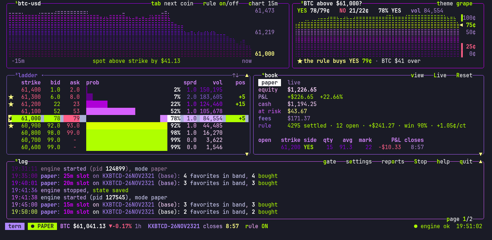

# tern

tern is a trading bot for Kalshi's hourly crypto above-or-below markets (BTC, ETH, SOL, XRP),
with a btop-style terminal screen: braille charts, a strike ladder, and paper and live books.
Every trade comes from its rule; there are no manual orders.
It paper trades from the start and sends no real order until you arm live.


- **Paper and live.** Every variant trades on paper all the time. Live is off until you arm it with one of them, and has its own caps, gate and daily loss limit.
- **Variants.** Ten built-in versions of the rule run side by side on paper, each with its own record. Make your own from the screen: any of their settings, saved as a new variant.
- **Reports.** Every variant's record on one screen, live or saved, with a weekly one if you want it.
- **Runs unattended.** The engine is separate from the screen and can run as a systemd service.
- **Web screen.** The same screen in a browser, view only.
- **56 color themes.**

## Quick start

tern needs Linux and Python 3.11 or newer, and nothing from pip. Paper trading needs no Kalshi account.

```
git clone https://github.com/samruger/tern.git
cd tern
python3 -m tern
```

That opens the screen and starts the engine in paper. `h` shows the help and `q` closes the screen; the
engine keeps running.

| Command | What it does |
|---|---|
| `python3 -m tern` | the screen; starts the engine in paper if it isn't running |
| `python3 -m tern run` | the engine in the foreground |
| `python3 -m tern status` | a plain-text summary |
| `python3 -m tern report` | the variants side by side, built in and your own |
| `python3 -m tern report --periods` | the same, by settings period |
| `python3 -m tern report --save` | saves a summary (status, variants) as `runtime/report-*.txt` |
| `python3 -m tern report-timer` | writes a systemd user timer that saves one every Monday at 10:00 |
| `python3 -m tern live-check` | tests your Kalshi key: balance and positions, no orders |
| `python3 -m tern service` | writes a systemd user service that keeps the engine running |
| `python3 -m tern web` | the screen in a browser: http://localhost:8787/ |
| `python3 -m tern web-service` | writes a systemd user service for the web screen |
| `python3 -m tern web-password` | sets the web screen's password |
| `python3 -m tern web-cert` | makes a self-signed certificate for the web screen |
| `python3 -m unittest tests.test_tern` | the tests |

## The rule

At **25, 20, 15 and 10 minutes before each hourly close**, for every strike whose
favorite side (YES or NO) has its mid between **75¢ and 95¢** and a spread of
**2¢ or less**, tern buys **5 contracts** of the favorite at the ask
(immediate-or-cancel) and holds to settlement. It puts at most **$60** into any
one hour. It trades BTC by default; a variant can trade others (see Variants).
These are the defaults, under `strategy` in `runtime/config.json`, which is
re-read every 5 seconds. The screen never changes the band, slots, spread, coins, size or paper
start there: a change made on the screen is a new variant (see Variants).

The rule comes from a study of 67 days of BTC and 14 days of ETH markets. In the BTC data, 80–90¢
favorites won about 2 points more often than their price said, and 5–20¢ long shots about 2 points less
often. The rule was picked on the first 33 days and made +0.6¢ a contract after fees on the next 34.
The write-up is [research/RESEARCH.md](research/RESEARCH.md).

## The screen

One box fills the screen: spot, contract, ladder, book, variants, log, gate, reports, settings, themes or help. The
others are tabs on its top border: the key on a tab (`1` to `9`, `0`, `h`) shows it, and `tab` and shift+tab step
through them. A box's own keys are on its bottom border and work only there; the log's are the ones that work everywhere. The status
line is always at the bottom.


| Box | What it shows |
|---|---|
| status line | paper/live, the variant selected, spot and 1-hour change, the event and its countdown, the rule's next slot, engine health |
| ¹ spot | Coinbase spot (a BRTI constituent), over 5 minutes, 15 minutes, 1 hour or 24 hours (`c`), with its change, high and low, and the selected strike as a dotted line |
| ² contract | the selected strike's YES price this hour, seeded from Kalshi's minute candles, with the rule's band edges marked |
| ³ ladder | every strike, high to low: bid, ask, probability bar, spread, volume, your position. ★ marks strikes in the rule's band |
| ⁴ book | the selected variant's money and record, its open positions, and beside them what settled and was filled. `V` switches between paper and live |
| ⁵ variants | each variant's record and gate progress, ● on the one selected, L on the one live trades, + on the ones you made, and the highlighted one's P&L by hour |
| ⁶ log | what the engine did. A slot is one entry, with what each variant bought, and so is an hour settling, with what each won. On its right: the coins, the selected variant's slots, warnings, and every variant's day |
| ⁷ gate | what the selected variant still needs to go live, the live caps, and every variant side by side |
| ⁸ reports | every record: worked out now, or saved |
| ⁹ settings | the settings, and what the one picked does |
| ⁰ themes | the color themes |
| help | how it works, the boxes and the keys, by section |

## Variants

There is one list of variants. The engine runs all of them on paper, side by side, each with its own record, its own
cash and real fees. Highlight one in the variants box (`5`) with `↑↓` and press `enter` to **select** it: the
book, ladder, contract and gate then show that variant, as if it were the only one. Selecting changes nothing
that trades. `L` goes live with the selected one (see Paper and live). These are built in:

| Variant | What it does |
|---|---|
| `base` | the rule under `strategy` in `config.json` |
| `band90` | only favorites at 90–95¢ |
| `cap1` | the rule, but at most one entry per strike per hour |
| `band80` | only favorites at 80–90¢ |
| `late` | only the 15m and 10m slots |
| `tight1` | only strikes with a 1¢ spread |
| `band75` | only favorites at 75–80¢; with `band80` and `band90` it splits the band in three |
| `early` | only the 25m and 20m slots, the other half of `late` |
| `multi` | the rule on every coin at once (BNB and HYPE too until 2026-11-24), each coin's hour with its own budget. Its dollars are up to four times `base`'s, so compare it by ¢/contract and t |
| `calm` | skips a slot when the coin's realized volatility over the last hour (one-minute returns) is above 7.6 bp/min |

Two earlier variants are retired: `stop20` (sell 20¢ under entry) and `arb` (a cross-strike pair under $1).

### Your own

A variant holds everything about how it trades: band, slots, max spread, coins, entries a strike, most
volatility, contracts a strike, most an hour, its limits (most at risk, largest order, daily loss limit) and paper start.
Once saved it never changes, so a record always belongs to one set of settings. The ones you make are marked `+` in the
variants box. The editor explains each setting, with examples from the values on screen and what the other variants use.

**Limits.** Paper and live both keep to a variant's limits, so its record is how live would trade. A buy over the largest
order, or that would pass most at risk, is cut to fit. Down by the daily loss limit since midnight, paper takes no new
entries until the next one; live turns off until `L`. The built-in variants, and your own from before 2026-11-24, kept
their paper as it was: only live keeps to their limits ($100, $25 and $30, from `config.json`; `live.limits` there gives a built-in variant its own).

- **`e` edits the highlighted one**, built in or your own: its settings open as a draft in the variants box, with the changes so far beside them. Change as many as you like; nothing is sent yet, and a changed one shows as `19 → 10 *`.
- **`s` there saves the draft as a new variant**, under a name you type, with an empty record. The one it came from
  stays as it is, with its record. `esc` throws the draft away.
- **`space` turns one off or on**, built in or your own. Off, it takes no new entries, open ones settle, and the hours
  don't count.
- **`D` deletes one of yours** (it asks `y`). If it bought anything its record stays on file and open entries settle.
- **`r` renames one** on the screen (up to 12 characters; empty gives its own name back). Its record, the gate,
  `config.json` and `tern report` keep its own name, so renaming never splits a record.
- **To start one over**, press `e` and `s`: the same settings, an empty record.

Built-in variants take
their size and paper start from `config.json`. No variant buys more than the cash it has left: its paper start, plus
its settled P&L, less what its open entries cost. It buys fewer contracts when that is all it can pay for, and nothing
when it is out. At most 24 of your own, kept in `variants.json` beside the records. The gate judges each variant on its
own record.



The engine also records what it sees to `runtime/ticks/`: every 5 seconds, each near-the-money strike's
bid, ask and sizes with spot, plus each hour's results (about 2 MB a day, gzipped). Kalshi keeps only
minute candles, so this is finer data for testing ideas.

## Two weeks on paper

`python3 -m tern report` after two weeks, taken 2026-11-23. The paper book went from $1,000.00 to
$1,220.26, with $166.38 paid in fees. Each variant's record, after fees, from the day it was added:

| Variant | Since | Hours | Entries | P&L | ¢/contract | Win | t |
|---|---|--:|--:|--:|--:|--:|--:|
| `base` | 11-09 | 323 | 3,853 | +$252.23 | +1.34 | 90% | +1.59 |
| `band90` | 11-09 | 323 | 1,972 | +$90.70 | +0.92 | 95% | +1.25 |
| `cap1` | 11-15 | 197 | 1,463 | +$72.03 | +0.99 | 89% | +0.91 |
| `band80` | 11-16 | 155 | 952 | +$27.30 | +0.57 | 87% | +0.35 |
| `late` | 11-16 | 156 | 931 | +$30.07 | +0.64 | 89% | +0.47 |
| `tight1` | 11-16 | 157 | 1,854 | +$21.14 | +0.23 | 89% | +0.18 |
| `band75` | 11-16 | 140 | 366 | −$20.45 | −1.13 | 78% | −0.50 |
| `early` | 11-16 | 155 | 1,291 | −$26.87 | −0.42 | 88% | −0.29 |
| `multi` | 11-16 | 157 | 4,134 | −$66.04 | −0.33 | 89% | −0.27 |
| `calm` | 11-20 | 47 | 501 | +$50.51 | +2.05 | 91% | +0.96 |
| `stop20` (retired 11-16) | 11-09 | 165 | 2,140 | −$190.72 | −1.82 | 68% | −3.01 |

Hours are the hours a variant traded. `multi` traded six coins then and the rest trade BTC. t is the average
hour's P&L divided by its standard error. These are paper results.

## Settings

The settings box (`9`) has the desk's settings: GATE, ALERTS, WEB, and what the log box shows. `PgUp` `PgDn` scroll what a setting is.
How anything trades is in its variant. Every change is written down with its time in `runtime/settings-log.jsonl`. A
hand edit of the strategy in `config.json` changes the built-in variants and starts a new settings period; rows are
stamped with theirs, and `python3 -m tern report --periods` splits the results by it.

When comparing variants, look at entries and t as well as P&L. t is the average hour's P&L divided by its standard
error; it shows after 10 hours.

**From before there was one list.** Until 2026-11-23 there were profiles, folders with variants and records of their
own, and one paper book. The first start moves the profiles' variants into the list with everything they bought: their
own ones keep running, and their copies of the built-in ones stop, with their records kept as deleted variants. The
folders move to `runtime/profiles-merged/`, the desk's files as they were stay beside them as `*.pre-merge`, and the
paper book as it was is in `paper-book.json`.


## Paper and live

Paper fills at the touch, limited to the size shown there, and pays the taker
fee rounded up per order, as Kalshi charges. It never spends more than its cash. Every variant that is on trades on
paper all the time, live or not, so its record keeps growing.

**Going live:** select a variant (`enter`), press `L` and type `live`. That sets `live.enabled` and `live.variant` in the
config. The engine then authenticates with your Kalshi key, and the status line turns red once Kalshi accepts it.
Selecting another variant later does not move live. `L` with another one selected asks whether to move live there (or
turn it off), and `L` with live's own selected turns it off. Once live:

- **The variant goes live only after its own paper record passes the
  gate** (`7`): 14 days, 300 settled entries, and P&L ≥ $0 after fees. Days are
  counted as hours it actually traded ÷ 24, so time with the engine or the variant off does
  not count. Moving live to another variant never skips this: that one needs its own record.
  14, 300 and $0 are the defaults; the settings box (`9`) changes them.
  Set `live.auto_needs_gate` to `false` to skip the gate.
- **Size:** live buys the variant's own contracts a strike, within its most an hour. Live never falls back to another
  variant: one that is off or gone enters nothing until you pick one.
- **Limits:** the variant's most at risk and largest order. Orders that only reduce a position are exempt from both.
- **Kill switch:** a live loss of the variant's daily loss limit since local
  midnight turns live off. Open positions are left to settle. Every order is
  immediate-or-cancel, so nothing is left resting on the book.
- **Kalshi is the record.** Every 15 seconds the engine reads your positions
  and overwrites its own when they differ. It reads the balance every 10
  seconds. Each order carries a unique `client_order_id`. If the reply is lost,
  the engine looks the order up by that id instead of sending it again.


The gate box (`7`) shows how far each check has come, the live caps and the variants. Here it has been set stricter than
the defaults, to 1000 entries and $100:


## Kalshi key

Only live trading needs a key. At kalshi.com, under Account → API keys, create one and download the private
key file. Ed25519 is Kalshi's default; RSA works too. Make the folder, save the file in it as `kalshi.pem`,
and write your key ID next to it:

```
mkdir -p ~/.config/tern && chmod 700 ~/.config/tern
cat > ~/.config/tern/kalshi.env <<EOF
KALSHI_KEY_ID=your-key-id
KALSHI_KEY_FILE=~/.config/tern/kalshi.pem
EOF
chmod 600 ~/.config/tern/kalshi.env ~/.config/tern/kalshi.pem
python3 -m tern live-check
```

Requests are signed (Ed25519 or RSA-PSS) in pure Python, checked against openssl in the tests.

## Keys

| Where | Key | What it does |
|---|---|---|
| everywhere | `1`–`9` `0` `h` `tab` shift+tab | show a box |
| everywhere | `↑↓` `j` `k` `PgUp` `PgDn` `Home` `End` | move in the box; so does the mouse wheel |
| everywhere | `t` / `T` | next / previous color theme |
| everywhere | `P` | pause (asks `y`) / start the engine |
| everywhere | `q` | close the screen; the engine keeps running |
| spot, contract, ladder | `C` | next coin |
| spot | `c` | chart span: 5m, 15m, 1h, 24h |
| book | `V` | paper / live book |
| book, variants, gate | `L` | live: on with the selected variant, off, or moved to it |
| variants | `enter` | select the highlighted one |
| variants | `e` | edit the highlighted one; `s` saves a new variant, `esc` discards |
| variants | `space` | turn the highlighted one on / off |
| variants | `D` `r` | delete / rename it |
| reports | `s` | save the one shown |
| settings | `←→` `enter` | step / type a value |
| themes | `↑↓` `←→` | pick one |

### Reports

The reports box (`8`) has the list on the left, in two parts:

- **LIVE:** what `tern report` prints, worked out from the records as they stand: the variants side by side, and by
  settings period. A report is worked out again when its records change; its first line says when it was.
- **SAVED:** the files named `report-*.txt` in `runtime/`, newest first, shown as written. `s` saves the live report
  on screen, `python3 -m tern report --save` a summary, and the weekly timer does that by itself:

```
python3 -m tern report-timer
systemctl --user daemon-reload
systemctl --user enable --now tern-save-report.timer
```

`↑↓` picks one and `PgUp` `PgDn` `Home` `End` scroll it. Reading one changes nothing, so the web screen has them too, without `s`.




## Themes

The themes box (`0`) lists 56 color themes; `↑↓` and `←→` pick one. `t` and `T` step through them
on any screen. Slate and ledger are the plain ones: one
accent, and color only for gains, losses and warnings. Full color needs a 256-color terminal. Slate, sunset and mint chip:








## The web screen

`tern web` serves the screen at http://localhost:8787/ (`--port` to move it). It is not a copy of the
screen: each browser tab runs the real screen code on a virtual terminal, and the page paints its cells
with the colors and font from foot's config if there is one, or a built-in set. So it looks and behaves the same: the tabs, `c`
chart span, `C` coins, `t`/`T` themes, `V` paper/live, `enter` selects a variant (for that browser),
themes, `↑↓ ←→` and the wheel. Clicking a tab, a key on a box's border, or a ladder or variant row
does what the key would; on a phone, drag to scroll.

It is view only. `q`, `P`, `L`, `r`, `D`, `space` and `e` do nothing there, and their
hints are not drawn. The settings box shows the settings but changes only what that browser's log box shows.
The web screen writes no command files and never touches the terminal's `dash.json` or `view.json`: each browser keeps its own settings. It writes `view-web.json` (in the same tmpfs folder)
with the coins and strikes its viewers have up, so the engine sends those strikes' contract history
too; the engine ignores the file 30 seconds after the last viewer leaves.



**Remote access.** Off localhost (`--host 0.0.0.0`) it will not start without a password and a TLS certificate.

```
python3 -m tern web-password
python3 -m tern web-service --host 0.0.0.0
systemctl --user daemon-reload
systemctl --user enable --now tern-web
```

The certificate can be either of these, put in place before the service starts:

- **Your own**, from Let's Encrypt or any other authority: save the full chain as
  `~/.config/tern/web-cert.pem` and its private key, without a passphrase, as `~/.config/tern/web-key.pem`
  (`chmod 600` both). Restart `tern-web` after renewing it.
- **Self-signed:** `python3 -m tern web-cert` makes one (it needs openssl) and prints its fingerprint.
  Browsers warn about a self-signed certificate; check that the fingerprint they show matches.

The password is stored as a PBKDF2 hash in `~/.config/tern/web.json`. A sign-in lasts 30 days in an HttpOnly,
Secure, SameSite=Strict cookie. After a new password, restart `tern-web`: every browser is then signed out.
`/logout` signs out the one you are on. Five wrong tries from one address make it wait 15 minutes, and 30 from
everyone make every sign-in wait. To reach it from another network, allow the port (8787 by default) through
the host's firewall, and forward it to the host if there is NAT in between.

**Settings box (`9`), WEB.** `web screen` turns it on and off, `port` moves it and `open to the
network` switches between every address and localhost only. tern-web.service runs
`tern web --config`, which reads those from `config.json`'s `web` section and exits (and stays down)
when it is off. The engine restarts or stops the service as soon as one changes, from the box or by
hand in `config.json`, and the box shows whether it is running and where to open it. Firewall and
port-forwarding rules are not touched: a new port needs its own.

## Files

`runtime/` (gitignored) holds `config.json`, `state.json` (the live book as it
stands, slots taken: a few KB, written only when it changes, with
an hourly `state.json.bak` that is loaded if the main file is damaged), the
history files that are only ever appended to (`live-trades.jsonl`, `live-curve.jsonl`),
the variants' records (`shadow.json`, open entries, and
`shadow-settled.jsonl`, append-only), `settings-log.jsonl`, `names.json` (display
names, once something is renamed), `variants.json` (your own variants, and which are off), `dash.json` (the screen's preferences), `ticks/`,
`tern.log` and `cmd/` (commands from the screen). The live
status file and the screen's selection live in tmpfs (`$XDG_RUNTIME_DIR/tern-*`),
because they are rewritten every second.

| Module | What it does |
|---|---|
| `config.py` | the settings, their defaults and the settings box's bounds |
| `strategy.py` | the favorite rule: which strikes qualify, when a slot is due |
| `book.py` | the live ledger, with Kalshi's YES-leg netting and fee |
| `engine.py` | polling, the rule, orders, settlement, live reconcile, kill switch, status |
| `net.py` | HTTPS over connections that stay open |
| `kalshi.py` | public and signed REST, V2 orders (`/portfolio/events/orders`) |
| `sign.py` | Ed25519 and RSA-PSS signing, PEM/DER parsing |
| `spot.py` | Coinbase ticker and candles |
| `shadow.py` | the built-in variants, and every variant's paper record (also each one's gate) |
| `variants.py` | the variants you make: their settings, names and file |
| `names.py` | the variants' display names, and the settings log |
| `merge.py` | moves the profiles of before into the one list, once |
| `record.py` | writes quotes and results to `runtime/ticks/` |
| `dash.py` | the curses screen |
| `themes.py` | the screen's 56 color themes |
| `web.py`, `web.html` | the same screen in a browser, view only |
| `webctl.py` | starts, stops and asks about tern-web.service for the settings box's WEB rows |
| `webauth.py` | tern web's password, sign-in cookie, wrong-guess limits and certificate |
| `research/` | the study's scripts and write-up |

## Notes

- Live order handling follows Kalshi's V2 docs. It has not yet been run with a real order. Start live with
  small caps and watch the first fills against kalshi.com.
- If the engine isn't running, nothing is watched. Positions still settle on
  Kalshi, because nothing rests on the book.

## Changes

The major ones, newest first.

| Date | Change |
|---|---|
| 2026-11-24 | **Limits are part of a variant:** most at risk, largest order and daily loss limit, on paper and live. Live buys the variant's own contracts a strike (it had a size of its own). The settings box and the editor explain each setting. BNB and HYPE are not traded any more. |
| 2026-11-23 | **One list of variants.** Profiles, the separate paper book and `w` are gone: `enter` selects the variant the screen shows, `L` goes live with it, `e` there edits one as a new one, `space` turns one on or off and `r` renames one. Every box fills the screen and the others are tabs (`1`–`9`, `0`, `h`, `tab`), the gate, reports, settings, themes and help too; the pages, zooming and the equity box are gone, `P` pauses the engine (was `S`), `C` cycles coins and `V` is the book's paper/live view. The book, gate, settings, help and the variant editor are laid out for the whole screen, and every theme has a color for each box and for the tabs; slate and ledger are new. The log has one entry a slot and an hour. Profiles' own variants move into the list with their records (see Settings). `tern report --profile` and `--profiles` are now `--periods`. |
| 2026-11-23 | **Cash limit on paper:** no variant, and not the paper book, buys more than the cash it has left. Entries from before could. A variant that is out of cash says so in the variants box. |
| 2026-11-23 | **Variants hold every trading setting**, contracts a strike, most an hour and paper start too. `E` opens them as a draft and `s` saves it as a new variant; a saved one never changes, and only `enter` changes what trades. Settings (`e`) has the profile and the desk only, the same under every profile. `n` in the variants box, and the rule, paper and "book trades" rows in settings, are gone. Variants saved before keep their profile's size. |
| 2026-11-23 | **AGPL license** (version 3 or later). It was MIT, then briefly the GPL; copies from then stay under those. |
| 2026-11-23 | **Your own variants.** Make, change and delete them from the screen (`n`, `E`, `D`), in each profile. Changing a rule makes a new variant with its own record; the built-in ones never change. Profile 1's settings show its variant and rule. Profiles that had changed their rule are converted (conversion since replaced, see Settings). |
| 2026-11-23 | **Reports screen** (`o`): what `tern report` prints, from the records as they stand, and the saved `report-*.txt` files. `s` there saves one, and `tern report-timer` sets up a weekly one. `S` (was `s`) stops and starts the engine. |
| 2026-11-23 | MIT license; README rewritten for anyone running it. |
| 2026-11-22 | **Any profile can go live** (`d`), past its own gate on its own record. |
| 2026-11-22 | Two pages (`p`), and a box's number zooms it to the whole screen. Hiding boxes is gone. |
| 2026-11-22 | `N` renames profiles and variants. The web screen's on/off, port and network are in the settings box. |
| 2026-11-21 | **Profiles:** copies of the desk with their own settings and records, and settings periods in the records. |
| 2026-11-21 | The web screen is back, with a login and HTTPS. |
| 2026-11-20 | Settings box (`e`), a size of its own for live, desktop alerts, log filter. |
| 2026-11-19 | Variant `calm`. |
| 2026-11-17 | The web screen, view only. |
| 2026-11-16 | **Variants box:** pick what trades, each with its own gate. New: `band80`, `late`, `tight1`, `band75`, `early`, `multi`. Retired: `stop20`, `arb`. `w` watches one. |
| 2026-11-16 | 54 color themes. History moves to append-only files, and HTTPS connections stay open. |
| 2026-11-15 | Manual orders and the auto switch are gone: the rule always trades. SOL, XRP, BNB and HYPE added. Variant `cap1`. |
| 2026-11-09 | Variants and the quote recorder. The daily loss limit measures realized plus open P&L, and the gate counts hours traded. |
| 2026-11-08 | First version. |

## License

Copyright (C) 2026 samruger

tern is free software: you can redistribute it and/or modify it under the terms of the GNU Affero General Public
License as published by the Free Software Foundation, either version 3 of the License, or (at your option) any
later version. It is distributed in the hope that it will be useful, but WITHOUT ANY WARRANTY; without even the implied
warranty of MERCHANTABILITY or FITNESS FOR A PARTICULAR PURPOSE. See [LICENSE](LICENSE) for the details.

The web screen's login page links to this repository. If you run a changed tern for other people, point the link
(`SOURCE` in `tern/web.py`) at your own source.
