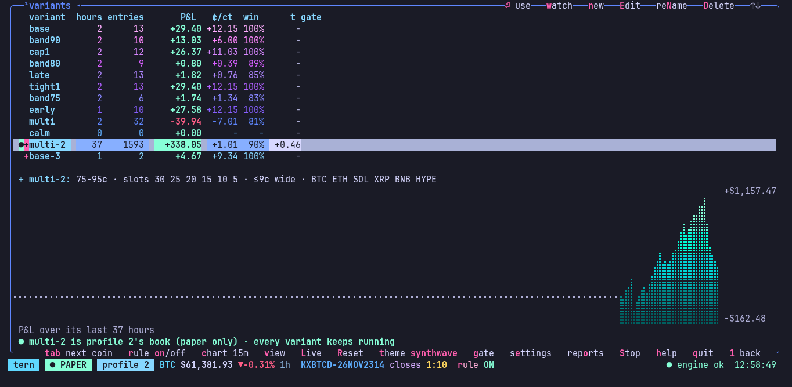
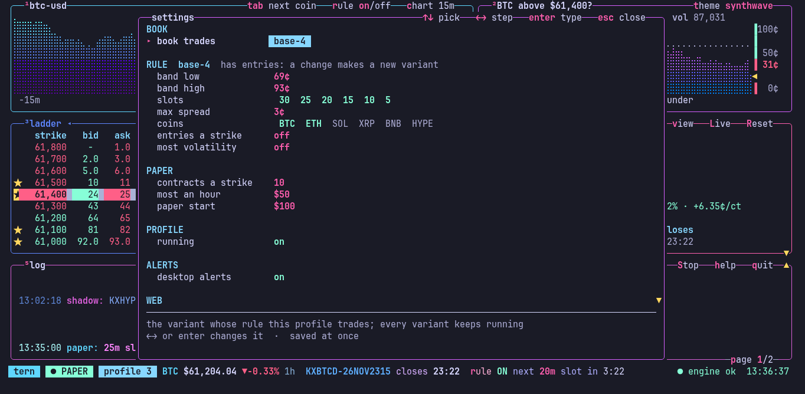
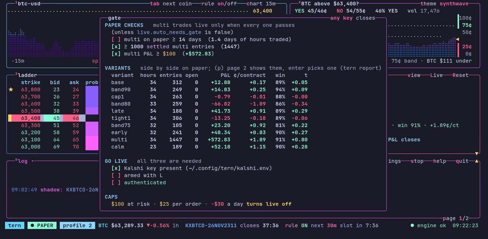
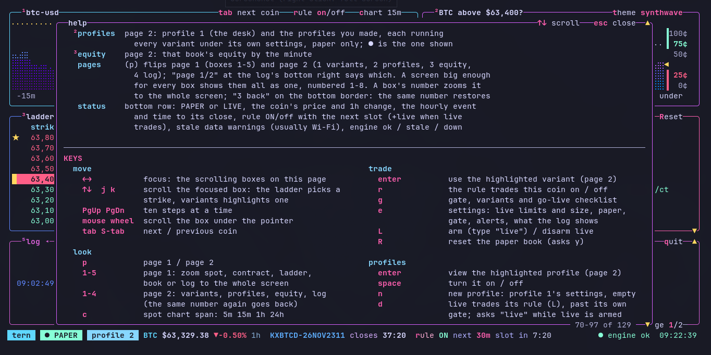

# tern

A desk for Kalshi's hourly crypto above-or-below markets (BTC, ETH, SOL, XRP, BNB, HYPE), with a btop-style
screen: braille charts, a strike ladder, and paper and live books.
Every trade comes from the rule; there are no manual orders.
It paper trades from the start and sends no real order until you arm live.


Python 3.11+, standard library only. Kalshi request signing (Ed25519 and RSA-PSS)
is written in pure Python and checked against openssl in the tests.

```
python3 -m tern               # the screen; starts the engine in paper if it isn't running
python3 -m tern run           # the engine in the foreground
python3 -m tern status        # plain-text summary
python3 -m tern report        # the rule's variants side by side
python3 -m tern report --profiles       # every profile's book side by side (--deleted: the deleted ones)
python3 -m tern report --profile NAME   # one profile's variants, by settings period
python3 -m tern live-check    # test your Kalshi key (balance, positions; no orders)
python3 -m tern web           # the screen in a browser, view only: http://localhost:8787/
python3 -m tern web-service   # a systemd user service for it (tern-web.service)
python3 -m tern service       # a systemd user service so the engine keeps running
python3 -m unittest tests.test_tern
```


## Where the rule comes from

The default rule comes from a study of Kalshi's hourly crypto markets, written up in
[research/RESEARCH.md](research/RESEARCH.md). On 67 days of BTC history, 80–90¢ favorites won about
2 points more often than their price said, and 5–20¢ long shots about 2 points less often. The rule
buys the favorite. It was picked on the first 33 days and made **+0.6¢ a contract after fees on the
next 34 days**. It makes about 10 entries an hour.



## The rule

At **25, 20, 15 and 10 minutes before each hourly close**, for every strike whose
favorite side (YES or NO) has its mid between **75¢ and 95¢** and a spread of
**2¢ or less**, it buys **5 contracts** of the favorite at the ask
(immediate-or-cancel) and holds to settlement. It puts at most **$60** into any
one hour. All of this is under `strategy` in `runtime/config.json`, re-read
every 5 seconds. It trades BTC only by default. `r` on another coin's view adds
that coin. The study covered 67 days of BTC and 14 days of ETH.


## Paper and live

Paper fills at the touch, limited to the size shown there, and pays the taker
fee rounded up per order, as Kalshi charges. Paper always runs the rule, even
while live is on, so its record keeps growing.

**Going live:** press `L` and type `live`. That sets `live.enabled` in the
config. The engine then authenticates with your key, and the header turns red
once it has. Press `L` again to return to paper. Once live:

- **The variant in use goes live only after its own shadow record passes the
  gate** (`g`): 14 days, 300 settled entries, and P&L ≥ $0 after fees. Days are
  counted as hours it actually traded ÷ 24, so time with the engine off does
  not count. Switching variants never skips this: the new one needs its own record.
  14, 300 and $0 are the defaults; the settings box (`e`) changes them.
  Set `live.auto_needs_gate` to `false` to skip the gate.
- **Caps:** `live.capital_usd` ($100) is the most at risk at once.
  `live.max_order_usd` ($25) is the largest single order. Orders that only
  reduce a position are exempt from both.
- **Kill switch:** a live loss of `live.max_daily_loss` ($30) since local
  midnight turns live off. Open positions are left to settle. Every order is
  immediate-or-cancel, so nothing is left resting on the book.
- **Kalshi is the record.** Every 15 seconds the engine reads your positions
  and overwrites its own when they differ. It reads the balance every 10
  seconds. Each order carries a unique `client_order_id`. If the reply is lost,
  the engine looks the order up by that id instead of sending it again.



## Variants

The engine also runs these on paper, side by side, each with its own record
and real fees. `python3 -m tern report`, `g`, or the
variants box (`p`, page 2) compares them. The paper and live books trade
whichever one `strategy.variant` names (`base` by default). Pick it in the
variants box with `↑↓` and `enter`. While live is on or armed, switching asks
you to type `live`.


To look at a variant without trading it, highlight it and press `w`. The book,
equity, ladder and band then show that variant's shadow record as if it traded
(on a $1,000 paper start), and the status line says `watching X · trading Y`.
Nothing about what trades changes. `w` again or `v` goes back to the real book.



The gate (`g`), here with stricter settings than the defaults: 1000 entries and $100.

| Variant | What it does |
|---|---|
| `base` | the rule as configured |
| `band90` | only favorites at 90–95¢ |
| `cap1` | the rule, but at most one entry per strike per hour (its hours start 2026-11-15) |
| `band80` | only favorites at 80–90¢, where the 67-day study found the bias (from 2026-11-16) |
| `late` | only the 15m and 10m slots (from 2026-11-16) |
| `tight1` | only strikes with a 1¢ spread (from 2026-11-16) |
| `band75` | only favorites at 75–80¢; with `band80` and `band90` it splits the band in three (from 2026-11-16) |
| `early` | only the 25m and 20m slots, the other half of `late` (from 2026-11-16) |
| `multi` | the rule on every coin at once, each coin's hour with its own budget. Its dollars are up to six times `base`'s, so compare it by ¢/contract and t (from 2026-11-16) |
| `calm` | skips a slot when the coin's realized volatility over the last hour (one-minute returns) is above 7.6 bp/min, the 75th percentile of `base`'s entry slots 11-09..11-18 (from 2026-11-20) |

Retired 2026-11-16, records kept in `runtime/shadow-settled.jsonl` and listed by `report`:
`stop20` (sell 20¢ under entry: −$191 over 165 hours, t −3.0) and `arb`
(cross-strike pair under $1: never fired in 165 hours).

It also records what it sees to `runtime/ticks/`: every 5 seconds, each
near-the-money strike's bid, ask and sizes with spot, plus each hour's results
(about 2 MB a day, gzipped). Kalshi keeps only minute candles, so this is the
data for testing ideas the first research could not.

## Profiles

The variants all share one set of settings. A profile is a whole copy of the
desk on paper with its own: band, slots, max spread, coins, contracts a strike,
most an hour, paper start, and the variant its book trades. Every variant runs
under each profile's settings, on the same prices at the same moment as the
desk, so a difference between two profiles comes from their settings, not
from timing.

- **Profile 1 is the desk:** the paper book, live and the gate, with its files
  where they always were. Live trades profile 1's rule unless `d` picks another profile.
- **Make one** in the profiles box (`p`, page 2; `←→` to focus it), then `n`. It starts
  with profile 1's settings and empty records. `enter` views it: the book,
  equity, variants box and settings box then show that profile. Viewing changes
  nothing about what trades. `space` turns one off (no new entries, open ones
  still settle) and on. `D` deletes it after you type `delete`; its folder moves
  to `runtime/profiles-deleted/`, nothing is erased. At most 8 besides profile 1.
- **Pick what goes live** with `d`: live then trades the highlighted profile's rule (its variant, band,
  slots, spread, coins and hourly budget) and its row is marked `L`. Live's own size and caps stay as they
  are. The gate is judged on that profile's own record of its variant, so a new pick starts its own
  clock. A live profile that is off or gone enters nothing, even with `live.auto_needs_gate` off: live
  never falls back to profile 1 by itself. While live is armed, `d` and any change to the live profile's
  variant or settings ask you to type `live`. The live profile can't be deleted (`d` another one first).
  Profile 1's paper book keeps trading profile 1's rule. It is `live.profile` in `config.json`.
- **Rename** with `N`: in the profiles box it renames the highlighted profile
  (profile 1 too; an empty name gives "profile 1" back), in the variants box it
  gives the highlighted variant a display name (up to 12 characters; empty gives
  its own back). A variant's record, the gate, `config.json` and `tern report`
  keep its own name, so renaming never splits a record. Names live in
  `runtime/names.json` (profile 1, variants) and each profile's `profile.json`.
- **Change its settings** with `e` while viewing it. Every change is written
  down with its time (`runtime/profiles/<id>/settings-log.jsonl`;
  `runtime/settings-log.jsonl` for profile 1), and a change to how records are
  made starts a new settings period. Rows are stamped with their period, so
  results can be split by it.
- **Compare:** `python3 -m tern report --profiles` puts each profile's book
  side by side; `--profile <name>` shows one profile's variants period by
  period with what changed; `--deleted` lists the deleted ones.

When comparing, look at entries and t as well as P&L. t is the average hour's P&L divided by its
standard error; it shows after 10 hours.

The web screen can view any profile; making, changing and deleting them stays
with the terminal.



## Kalshi key

At kalshi.com, under Account → API keys, create a key and download the private
key file. Ed25519 is Kalshi's default; RSA works too. Then:

```
mkdir -p ~/.config/tern && chmod 700 ~/.config/tern
cat > ~/.config/tern/kalshi.env <<EOF
KALSHI_KEY_ID=your-key-id
KALSHI_KEY_FILE=~/.config/tern/kalshi.pem
EOF
chmod 600 ~/.config/tern/kalshi.env ~/.config/tern/kalshi.pem
python3 -m tern live-check
```

## The screen

The boxes sit on two pages, and `p` flips between them. Page 1 · trade has spot, contract, ladder, book
and log. Page 2 · compare has variants across the full width, then profiles and equity, then log. Each
page fits itself to the terminal: tables keep all their rows and the charts give up height first. A screen big
enough for every box (about 150×45) shows them all as one page. Each page numbers its boxes in reading order
(page 1: 1–5, log is 5; page 2: 1 variants, 2 profiles, 3 equity, 4 log), and `page 1/2` at the log's bottom
right says which page it is. A box's number zooms it to the whole screen; the same number again (the bottom border says `3 back`)
restores the page, and `p` restores it and flips.

| Box | What it shows |
|---|---|
| status line | paper/live, spot and 1-hour change, the event and its countdown, the rule's next slot, engine health |
| ¹ spot | Coinbase spot (a BRTI constituent), over 5 minutes, 15 minutes, 1 hour or 24 hours (`c`), with the selected strike as a dotted line |
| ² contract | the selected strike's YES price this hour, seeded from Kalshi's minute candles, with the rule's band edges marked |
| ³ ladder | every strike, high to low: bid, ask, probability bar, spread, volume, your position. ★ marks strikes in the rule's band |
| ⁴ book | equity, P&L, cash, at risk, fees, the rule's paper record, and open positions. `v` switches between paper and live |
| ⁵ log | what the engine did (page 2: ⁴) |
| ¹ variants (page 2) | each variant's record and gate progress, ● on the one in use, and the highlighted one's P&L by hour |
| ² profiles (page 2) | profile 1 and the profiles you made (see Profiles) |
| ³ equity (page 2) | that book's equity by the minute |

Keys: `p` page 1 / page 2 · `↑↓` / `PgUp PgDn` move in the focused box · `←→` focus · `1`–`5` (page 1), `1`–`4` (page 2) or `1`–`8` (one big screen) zoom a box to the whole screen, the same number goes back · `enter` use the highlighted variant or view the highlighted profile (whichever box has focus) · `w` watch a variant (view only) · `tab` / shift+tab next / previous coin · `r` rule trades this coin ·
`c` chart span · `t` / `T` next / previous of 54 color themes · `v` book · `L` arm/disarm live · `g` gate · `e` settings · `R` reset paper ·
`s` stop (asks `y`) / start the engine · `h` or `?` help · `q` close (the engine keeps running).
`j` / `k` move like `↓` / `↑`, and the mouse wheel scrolls the box under the pointer.

In the profiles box: `enter` view · `space` on/off · `n` new · `d` live trades its rule · `D` delete ·
`N` rename (in the variants box, `N` renames a variant). See Profiles.


## The web screen

`tern web` serves the screen at http://localhost:8787/ (`--port` to move it). It is not a copy of the
screen: each browser tab runs the real screen code on a virtual terminal, and the page paints its cells
with the colors and font from foot's config if there is one, or a built-in set. So it looks and behaves the same: `p` pages, box numbers, `c`
chart span, `tab`/shift+tab coins, `t`/`T` themes, `v` paper/live, `w` watch a variant, `g` gate, `h`
help, `↑↓ ←→` and the wheel. Clicking a key on a box border, a box's number, or a ladder or variant row
does what the key would; on a phone, drag to scroll.

It is view only. `q`, `s`, `R`, `L`, `r`, `N` and `enter` on a variant do nothing there, nor do `space`,
`n`, `d` and `D` in the profiles box, and their hints are not drawn. `enter` on a profile views it, and the
settings box (`e`) shows the settings but changes only what that browser's log box shows. It writes no command files and never touches the screen's `dash.json` or
`view.json`: each browser keeps its own settings. It writes `view-web.json` (in the same tmpfs folder)
with the coins and strikes its viewers have up, so the engine sends those strikes' contract history
too; the engine ignores the file 30 seconds after the last viewer leaves.

**Remote access.** Off localhost (`--host 0.0.0.0`) it will not start without a login and HTTPS:

```
python3 -m tern web-password                # a password (enter none for a generated one)
python3 -m tern web-cert                    # a self-signed certificate; prints its fingerprint
python3 -m tern web-service --host 0.0.0.0  # then: systemctl --user enable --now tern-web
                                            # (--host sets the settings box's "open to the network")
```

Both live in `~/.config/tern/`, never in the repo. The password is stored as a PBKDF2 hash. A sign-in
lasts 30 days in an HttpOnly, Secure, SameSite=Strict cookie. Setting a new password signs every
browser out, and `/logout` signs out the one you are on. Five wrong tries from one address make it wait
15 minutes, and 30 from everyone make every sign-in wait. The certificate is self-signed, so each
browser warns once. Check that the fingerprint it shows matches the one `web-cert` printed before you
accept it. To reach it from another network, allow the port (8787 by default) through the host's firewall, and
forward it to the host if there is NAT in between.

**Settings box (`e`), WEB.** `web screen` turns it on and off, `port` moves it and `open to the
network` switches between every address and localhost only. tern-web.service runs
`tern web --config`, which reads those from `config.json`'s `web` section and exits (and stays down)
when it is off. The engine restarts or stops the service as soon as one changes, from the box or by
hand in `config.json`, and the box shows whether it is running and where to open it. Firewall and
port-forwarding rules are not touched: a new port needs its own.


## Files

`runtime/` (gitignored) holds `config.json`, `state.json` (the books as they
stand, open entries, slots taken: a few KB, written only when it changes, with
an hourly `state.json.bak` that is loaded if the main file is damaged), the
history files that are only ever appended to (`paper-trades.jsonl`,
`paper-curve.jsonl`, `live-trades.jsonl`, `live-curve.jsonl`,
`rule-entries.jsonl`), the variants' records (`shadow.json`, open entries, and
`shadow-settled.jsonl`, append-only), `settings-log.jsonl`, `names.json` (display
names, once something is renamed), `dash.json` (the screen's preferences), `ticks/`,
`tern.log` and `cmd/` (settings commands from the screen). Each extra profile has a folder under
`profiles/` with its own `profile.json`, `config.json`, variants' records and
`settings-log.jsonl`; a deleted one moves to `profiles-deleted/`. The live
status file and the screen's selection live in tmpfs (`$XDG_RUNTIME_DIR/tern-*`),
because they are rewritten every second.

| Module | What it does |
|---|---|
| `config.py` | the settings, their defaults and the settings box's bounds |
| `strategy.py` | the favorite rule: which strikes qualify, when a slot is due |
| `book.py` | the ledger for paper and live, with Kalshi's YES-leg netting and fee |
| `engine.py` | polling, the rule, orders, settlement, live reconcile, kill switch, status |
| `net.py` | HTTPS over connections that stay open |
| `kalshi.py` | public and signed REST, V2 orders (`/portfolio/events/orders`) |
| `sign.py` | Ed25519 and RSA-PSS signing, PEM/DER parsing |
| `spot.py` | Coinbase ticker and candles |
| `shadow.py` | the variants, each with its own paper record (also each one's gate) |
| `profiles.py` | profiles: their folders, settings, records and names |
| `record.py` | writes quotes and results to `runtime/ticks/` |
| `dash.py` | the curses screen |
| `themes.py` | the screen's 54 color themes |
| `web.py`, `web.html` | the same screen in a browser, view only |
| `webctl.py` | starts, stops and asks about tern-web.service for the settings box's WEB rows |
| `webauth.py` | tern web's password, sign-in cookie, wrong-guess limits and certificate |
| `research/` | the scripts and data behind the numbers above |


## Notes

- Live order handling follows Kalshi's V2 docs. It has not yet
  been run with a real order. Start live with small caps and watch the first fills against
  kalshi.com.
- If the engine isn't running, nothing is watched. Positions still settle on
  Kalshi, because nothing rests on the book.
